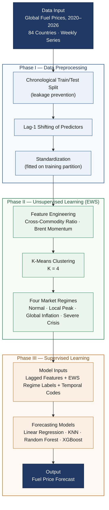

# Methodology Flowchart — Mermaid Source

This file contains the Mermaid.js source for the 3-Phase methodology pipeline
(Section 3). Paste the code block below into a Mermaid renderer (e.g.,
https://mermaid.live), export as PNG/SVG, and insert the image into your Word
document. Many Markdown editors and the Mermaid Live Editor render it directly.

